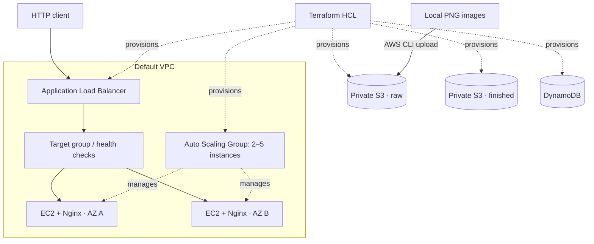

# AWS Multi-AZ Infrastructure Automation

**Terraform · AWS EC2 · Application Load Balancer · Auto Scaling · S3 · DynamoDB · Bash**

This repository demonstrates Infrastructure as Code for deploying a multi-availability-zone web-server environment on AWS, alongside object storage, a NoSQL table, shell automation, and lifecycle management.

## Architecture

This is a visual diagram of the infrastructure created through mermaid.js. 



The sample upload process stores PNG files in the **raw S3 bucket**. The `finished` bucket is separately provisioned.

## AWS services and technologies

| Technology | Role |
| --- | --- |
| **Terraform (HCL)** | Infrastructure provisioning and teardown |
| **Amazon VPC / subnets** | Default VPC and availability-zone placement |
| **Amazon EC2** | Launch template and Nginx-based HTTP instances |
| **Application Load Balancer** | Distributes incoming HTTP traffic to healthy targets |
| **EC2 Auto Scaling Group** | Maintains configurable capacity of 2–5 instances across zones |
| **Amazon EBS** | Encrypted gp3 data volumes specified in the launch template |
| **Amazon S3** | Private raw and finished object-storage buckets |
| **Amazon DynamoDB** | NoSQL table and optional fictional sample record |
| **Bash / AWS CLI** | Web server bootstrap, sample image upload, and infrastructure checks |

## Repository structure

```text
aws-terraform-cloud-infrastructure/
├── README.md
├── .gitignore
├── provider.tf
├── versions.tf
├── variables.tf
├── terraform.tfvars.example
├── data.tf
├── network.tf
├── compute.tf
├── load_balancer.tf
├── storage.tf
├── database.tf
├── outputs.tf
├── scripts/
│   ├── install-env.sh
│   ├── upload-s3-images.sh
│   ├── check.sh
│   └── smoke-test.sh
├── assets/sample-images/
│   └── README.md
└── docs/
    └── architecture.md
```

## Infrastructure workflow

These commands illustrate the infrastructure lifecycle. **AWS credentials and an AWS account with the required permissions are needed only if you choose to deploy it.** Deployment will incur charges.

### 1. Configure and validate

```bash
cp terraform.tfvars.example terraform.tfvars
# Customize terraform.tfvars for your AWS environment
terraform init
terraform fmt -check -recursive
terraform validate
terraform plan
```

### 2. Provision resources

```bash
terraform apply
terraform output application_url
```

The EC2 launch template uses `scripts/install-env.sh` as user data to install, enable, and start Nginx.

### 3. Upload images to S3 (optional)

Add your own PNG files to `assets/sample-images/`, then run:

```bash
bash scripts/upload-s3-images.sh raw --dry-run
bash scripts/upload-s3-images.sh raw
aws s3 ls "s3://$(terraform output -raw raw_s3_bucket_name)/portfolio-samples/"
```

The script looks up the bucket using Terraform output and uploads files with the AWS CLI. I did not upload the sample images to this repository due to copyright issues. 


### 4. Check infrastructure (optional)

```bash
bash scripts/smoke-test.sh
```

The helper checks the HTTP endpoint, S3 bucket access, and DynamoDB table status in the selected AWS account.

### 5. Tear down resources

Remove any sample objects **you uploaded** before destroying the infrastructure, as the S3 buckets are intentionally configured not to force-delete objects:

```bash
RAW_BUCKET="$(terraform output -raw raw_s3_bucket_name)"
aws s3 rm "s3://${RAW_BUCKET}/portfolio-samples/" --recursive
terraform destroy
```

Review the AWS account afterward to ensure no resources remain billable. Verify the bucket/prefix before deleting any objects.


